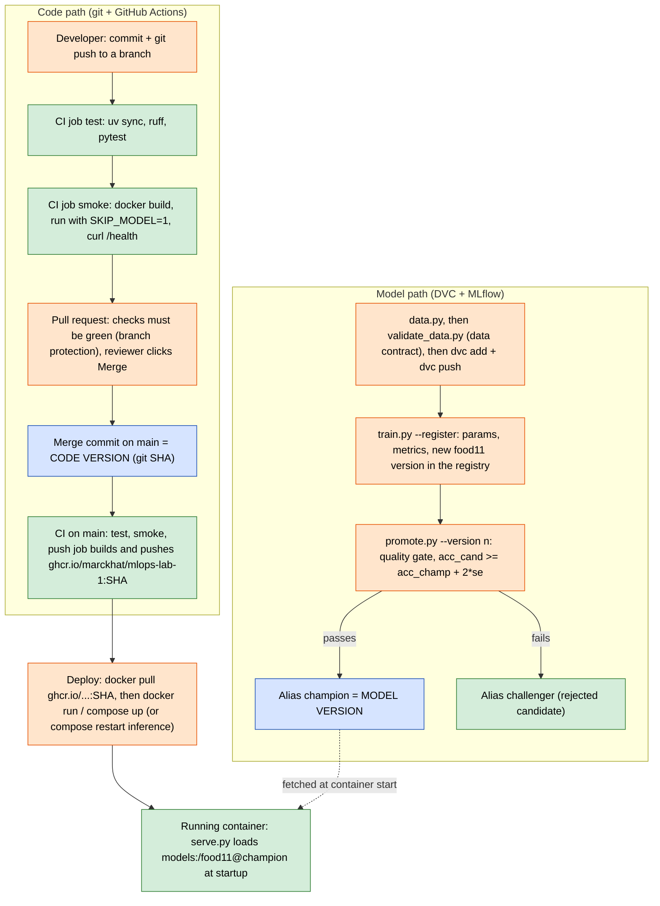

# Lab 5 - CI/CD with GitHub Actions

## What was built

| File | Purpose |
|---|---|
| `src/food11/data.py` | Refactored: `CLASSES`, `category_from_filename()`, `resize_image()` are pure functions; the copy loop only runs under `if __name__ == "__main__":`. `resize_image()` now also converts to RGB. After the lab, `find_duplicates()` removes the train/test leak (see the last section). |
| `src/food11/serve.py` | The model lives in a module-level `model` variable, loaded at startup only if `SKIP_MODEL` is not set. `/health` always answers 200; `/predict` returns 503 when no model is loaded. |
| `src/food11/validate_data.py` | Data contract: 5 checks, PASS/FAIL report, exit code 1 on failure. |
| `src/food11/promote.py` | Quality gate that moves the `champion` alias only if the candidate is better by at least 2 standard errors. It refuses to compare runs measured on different test sets; `--rebaseline` is the explicit way out after a data change. |
| `src/food11/train.py` | Small additions: reads `MLFLOW_TRACKING_URI` from the environment, logs `test_size` and `test_set_md5` (a fingerprint of the test images), and `--register` registers the model as a new `food11` version. |
| `tests/` | 23 tests: data functions, API with a fake model, the data contract on a synthetic dataset, and the gate rule (plus duplicate removal and test-set comparability). `tests/fixtures/bread.jpg` is a 4 kB image from the mini dataset, committed to git. |
| `.github/workflows/ci.yml` | `test` → `smoke` → `push` (main only, to ghcr.io, tagged with the commit SHA). |
| `scripts/register_model.py` | (Lab 4 script) now also copies `test_accuracy`, `dataset` and `test_size` from the source run, so imported models can be compared by the gate. |

### Notes and deviations from the handout

* **`lifespan` instead of `@app.on_event("startup")`.** `on_event` is deprecated in FastAPI and was removed from Starlette 1.x (installed: Starlette 1.6.0). The `lifespan` context manager does the same thing (runs `load_model()` once at startup) and `TestClient` still triggers it inside `with TestClient(app)`.
* **Action versions.** The handout uses `actions/checkout@v4`, `astral-sh/setup-uv@v5`, `docker/*@v3`/`@v6`. These run on Node 20, which GitHub has retired. I used the current majors (`checkout@v7`, `setup-uv@v10`, `setup-buildx-action@v4`, `login-action@v4`, `build-push-action@v7`); their inputs used here are unchanged.
* **Ruff 0.17 default rules** are stricter than older versions (import sorting, `B008`, `BLE001`, ...). Fixes: `Annotated[UploadFile, File()]` instead of `File(...)` as a default value, a narrower `except` in the validator, and `known-third-party = ["mlflow"]` in `pyproject.toml` because the `./mlflow/` folder (the Compose service) made ruff think `mlflow` was a local package.
* **`[tool.pytest.ini_options] pythonpath = ["."]`** so tests can `import src.food11...`, the same way the Docker image imports `src.food11.serve:app`.
* **FakeModel** returns a numpy array of 11 *logits*, like the real MLflow pyfunc model, because `serve.py` applies softmax to the model output. It also asserts that it receives a `(1, 3, 128, 128)` batch.
* **Local pytest temp folder.** On my laptop, pytest's default temp folder `%TEMP%\pytest-of-User` (left over from an older run) has broken permissions (`PermissionError: [WinError 5]`). Locally I ran `uv run pytest -q --basetemp=<another folder>`. This does not affect CI (Linux runner).

---

## Question 1 - Why should a unit test not load the real model from MLflow?

A unit test should check **my code**, quickly and the same way every time. Loading the real model makes the test depend on things outside the code:

1. **No server in CI.** The GitHub runner has no MLflow server (mine runs on my laptop / in Docker Compose). `load_model("models:/food11@champion")` fails with a connection error, even though the code is correct.
2. **The registry changes.** If someone moves the `champion` alias, deletes a version, or runs `docker compose down -v` (Lab 4 Q10), the model is different or gone. The same commit passes today and fails tomorrow.
3. **Different model, different answer.** A test that expects "Bread" for `bread.jpg` fails when a new champion predicts something else, or when the model has lower accuracy: that is a model-quality problem, not a code bug.
4. **Slow and heavy.** Downloading ~45 MB of weights and running ResNet on CPU on every test run makes the test take much longer than a second.
5. **Credentials and network.** A hosted MLflow (e.g. DagsHub) needs secrets; a network timeout fails the test.

**In simple terms: unit tests test the code; the model is tested by the quality gate (and its metrics), not by unit tests.**

---

## Question 2 - What does `test_predict_returns_valid_json` prove?

**It proves that:**

* the endpoint accepts a multipart file upload named `file`;
* a real JPEG is decoded, converted to RGB and transformed into a tensor of shape `(1, 3, 128, 128)` (the fake model asserts the shape);
* the model output is turned into probabilities (softmax) and the arg-max index is mapped to the right class name (`0 -> "Bread"`);
* the response is HTTP 200 with JSON containing `category` (a string) and `confidence` (between 0 and 1);
* the app starts without MLflow when `SKIP_MODEL` is set.

**It does not prove that:**

* the real model loads from MLflow (`models:/food11@champion`), or that the server is reachable;
* the real pyfunc model accepts this input (numpy float32, NCHW) and returns logits in this shape;
* the model's predictions are correct: "Bread" comes from the fake model, not from the image;
* the class order of the trained model matches `CLASSES` (a separate test checks that `CLASSES` is in the alphabetical `ImageFolder` order);
* anything about speed, memory, or behaviour with large or unusual images.

**In simple terms: it tests the plumbing around the model, not the model.**

---

## Question 3 - Which check caught the duplicate?

**Finding first: the original Food-11 dataset already breaks check 4.** The first run on the clean mini dataset already failed:

```text
$ uv run python src/food11/validate_data.py data/food11_processed_mini
Data contract for data\food11_processed_mini
  PASS  1. class folders - 11 classes expected in each of 3 splits
  PASS  2. images RGB 128x128 - 3292 images checked, 0 bad
  PASS  3. at least 50 images per class - smallest class has 96 images
  FAIL  4. no image in two splits - 43 images shared between splits
          same image in several splits: training/Bread/0_106.jpg, evaluation/Bread/0_131.jpg
          same image in several splits: training/Bread/0_186.jpg, evaluation/Bread/0_139.jpg
          same image in several splits: training/Dairy product/1_185.jpg, validation/Dairy product/1_123.jpg
          ...
  PASS  5. class shares train vs val within 5% - largest gap 0.3%
FAILED: 1 of 5 checks failed
```

On the full `food11_processed` (16,643 images) it finds **611** images shared between splits. I checked the raw Kaggle files with the same MD5 method: the 611 groups are **byte-identical in `food11_raw`** too (249 training/evaluation, 51 training/validation, 311 validation/evaluation), always with the same label. So the leak comes from the source dataset, not from `data.py`. After answering the lab questions I fixed it in `data.py`; see "Fix: removing the train/test leak" at the end.

**Then the deliberate break.** I copied `training/Bread/0_0.jpg` to `evaluation/Bread/copy_of_0_0.jpg`:

```text
  PASS  2. images RGB 128x128 - 3293 images checked, 0 bad
  FAIL  4. no image in two splits - 44 images shared between splits
          same image in several splits: training/Bread/0_0.jpg, evaluation/Bread/copy_of_0_0.jpg
```

**Check 4 (no image in two splits)** caught it: the count went from 43 to 44 and the new pair is listed first. Checks 1, 2, 3 and 5 still pass, because the copy is a valid 128x128 RGB image in the right folder and one extra image barely changes the class shares. After removing the copy the count went back to 43 and `dvc status` reported `Data and pipelines are up to date`.

**Why a train/test duplicate is more dangerous than a corrupted image:**

* A corrupted image is **loud**: the `DataLoader` raises an exception, training stops, someone fixes the file. Nothing wrong reaches the registry.
* A duplicate is **silent**: training succeeds and the metrics look *better* than they really are. The model has already seen (and memorised) that image, so it is "tested" on its own training data. `test_accuracy` is over-estimated, which means:
  * the quality gate compares inflated numbers and can promote the wrong model (a model that memorises more looks better);
  * the accuracy reported to users or management is wrong, and the real performance on new images is only found in production;
  * in Lab 2 the best run was chosen by `val_accuracy`; with 311 images shared between validation and evaluation, the test set does not independently confirm that choice.

**In simple terms: a crash stops you; a leak lies to you.**

---

## Question 4 - Where should `validate_data.py` run?

The GitHub runner has no data (it is in DVC), so the data contract must run where the data is:

1. **When the data is produced, before it is versioned.** Right after `uv run python src/food11/data.py` and **before** `dvc add data` / `dvc push`, for example as a git pre-commit hook on `data.dvc`, or as a `validate` stage in a DVC pipeline (`dvc.yaml`) that depends on `data/food11_processed`. Bad data then never gets a `data.dvc` pointer and never reaches the remote.
2. **At the start of training, before the first epoch.** As the first step of the training job (or at the top of `train.py`) on the machine that trains, so a model is never trained or evaluated on data that breaks the contract, and its metrics never reach the registry.

A third option is a CI job that runs `dvc pull data/food11_processed_mini` from the DagsHub remote (with the DagsHub token stored as a GitHub secret) and then the validator. In the current CI, `tests/test_validate_data.py` already checks that **the validator itself** works, on a small synthetic dataset built in a temp folder.

---

## Question 5 - What does `needs: test` do?

If a unit test fails, the `test` job fails and the `smoke` job is **skipped** (it does not start). The `push` job, which `needs: smoke`, is skipped too, so a broken commit never produces an image in the registry.

Without `needs`, jobs run **in parallel**, on separate runners. `smoke` would start immediately and build the image even when the tests fail. That wastes runner minutes, and if `push` also had no `needs`, an image of broken code could be pushed to ghcr.io.

**In simple terms: `needs` turns independent jobs into a pipeline where each stage is a gate for the next.**

---

## Question 6 - How long did the run take, and what got faster?

The very first run failed in 2 seconds at "Set up job": `Unable to resolve action astral-sh/setup-uv@v10, unable to find version v10`. That action no longer publishes a floating major tag, so I pinned the exact release `v10.3.3`. The runs below are the green ones on the `lab5-ci-cd` branch (the `push` job is skipped off `main`).

| Run | Total | `test` job | setup-uv | `uv sync --frozen` | `pytest` | Post setup-uv (save cache) | `smoke` job | `docker build` |
|---|---|---|---|---|---|---|---|---|
| #2 (commit `e162323`, cold uv cache) | 2 min 6 s | 33 s | 1 s | 6 s | 13 s | 7 s | 1 min 26 s | 66 s |
| #3 (empty commit `8517375`, warm uv cache) | 2 min 8 s | 28 s | 6 s | **3 s** | 13 s | **1 s** | 1 min 34 s | 72 s |

* **The `test` job got faster (33 s → 28 s)**, thanks to `setup-uv` with `enable-cache: true`. Run #2 started with no cache: `uv sync` downloaded every package (6 s) and the post step uploaded uv's cache (7 s), keyed on `uv.lock`. In run #3 the key matched (same `uv.lock`), so `setup-uv` restored the cache (~5 s more in that step), **`uv sync` dropped to 3 s**, and the save step was skipped (1 s). On GitHub's fast network the cold download is already quick, so the gain is only a few seconds; on a slow network, or with the multi-GB CUDA build of torch, it would be minutes.
* **The `smoke` job did not get faster** (1 min 26 s → 1 min 34 s). It runs a plain `docker build` on a brand-new runner: there is no layer cache from the previous run, so the base image is pulled and `uv sync` inside the Dockerfile reinstalls everything every time. That build is now the slowest step of the pipeline. The `push` job avoids this with `cache-from/cache-to: type=gha` (BuildKit layers stored in the GitHub Actions cache); the same could be added to `smoke` with `docker/build-push-action` and `load: true`.
* Total time is about **2 minutes**, dominated by the Docker build.

**In simple terms: every run starts on an empty machine; only what you explicitly cache comes back, and here only the Python packages were cached.**

---

## Question 7 - Why tag with the commit SHA instead of `latest`?

This answers Lab 3, Question 9: the image now lives in a registry (`ghcr.io/marckhat/mlops-lab-1`) under a name that any machine can pull, and the tag says **exactly which code** it contains.

* A **commit SHA tag is immutable in meaning**: `:<sha>` always means "the code of that commit". From a running container I can go back to the exact commit, the CI run that tested it, and the diff. Rolling back means deploying the previous SHA.
* **`latest` is a moving pointer**: every push to `main` overwrites it. It says nothing about which code is inside, and two pulls of `latest` at different times give different images.

**Concrete situation:** on Monday, server A runs `docker pull ghcr.io/marckhat/mlops-lab-1:latest` and gets the image of commit `abc123`. On Tuesday a commit `def456` changes the preprocessing in `serve.py` (say, a different normalisation) and CI pushes a new `latest`. On Wednesday a second server B is added behind the same load balancer and pulls `latest`: it gets `def456`. Both servers report the tag `latest`, but A still runs the old code (Docker does not re-pull an image it already has), so the same photo gets two different predictions depending on which server answers, and nobody can tell from the tag why. The same happens in Kubernetes when a pod is rescheduled on a node that has an older `latest` cached. With SHA tags, A and B are both told "run `:def456`" (or both stay on `:abc123`) and the difference is visible.

**In simple terms: `latest` is a nickname that keeps changing; the SHA is a fingerprint.**

---

## Question 8 - Why does the `push` job declare `permissions:`?

`GITHUB_TOKEN` gets the repository's default permissions unless the workflow says otherwise. Depending on the repository/organisation settings, that default can be **read and write on almost everything** (contents, packages, pull requests, issues, actions, ...).

Declaring `permissions:` applies the **principle of least privilege**: this job only needs to read the code (`contents: read`) and to push an image (`packages: write`). Every other permission becomes `none`.

A compromised step (a malicious or hijacked third-party action, a poisoned dependency installed during the build, ...) can read the token from the runner. With write access to everything it could:

* push commits or tags to `main` (for example a backdoor in `serve.py`), or delete branches;
* create a release, or overwrite images and other packages;
* open or merge pull requests, edit issues and comments;
* re-run or cancel other workflow runs (`actions: write`).

With `contents: read` + `packages: write`, the worst it can do is push an image to this repository's package, and the token expires at the end of the job.

**In simple terms: give each job only the keys it needs, so a stolen key opens as few doors as possible.**

---

## Question 9 - Branch protection and a failing pull request

**Rule** (Settings → Branches → branch protection rule for `main`):

* ✅ Require a pull request before merging (with *Require approvals* turned **off**: on a one-person repo I cannot approve my own PR, so 1 required approval would block every merge)
* ✅ Require status checks to pass before merging → required checks: **`test`** and **`smoke`**

The rule was added after the Lab 5 code was merged to `main` through [PR #1](https://github.com/marckhat/mlops-lab-1/pull/1) (the `main` run of that merge pushed `ghcr.io/marckhat/mlops-lab-1:bbb98f6c...`; see Q12).

**The broken pull request.** On a new branch `break-test` I changed `category_from_filename` to return `CLASSES[(int(label) + 1) % len(CLASSES)]` (every class shifted by one) and opened [PR #2](https://github.com/marckhat/mlops-lab-1/pull/2).

The `test` job failed (on both the `push` and the `pull_request` events):

```text
    def test_category_from_filename():
>       assert category_from_filename("0_12.jpg") == "Bread"
E       AssertionError: assert 'Dairy product' == 'Bread'
FAILED tests/test_data.py::test_category_from_filename - AssertionError: assert 'Dairy product' == 'Bread'
1 failed, 18 passed, 2 warnings in 9.43s
```

**What the pull request page showed:**

* a red ❌ next to the commit and a box **"Some checks were not successful - 2 failing, 4 skipped checks"**;
* `ci / test (pull_request)` *Failing after 28s* and `ci / test (push)` *Failing after 25s*, both labelled **Required**;
* `ci / smoke` **skipped** (because of `needs: test`, Q5) but still labelled **Required**, and `ci / push` skipped (not `main`);
* a greyed-out **Merge pull request** button and the message *"Merging is blocked due to failing merge requirements"*.

**Could I still merge?** Not normally: the button is disabled. Because I am the repository **admin**, GitHub also showed an unchecked box *"Merge without waiting for requirements to be met (bypass rules)"*. An admin can bypass on purpose; a normal collaborator cannot. Ticking *"Do not allow bypassing the above settings"* in the rule would remove that option for admins too. I did not bypass.

**Fix.** I reverted the line, pushed again to the same branch: the checks re-ran on the new commit, turned green, and the PR could be merged.

**What this changes for a team, compared to "everybody runs the tests on their laptop":**

* **Enforced, not trusted.** The server refuses the merge; nobody has to remember, and "I forgot" or "it's a tiny change" no longer gets broken code into `main`.
* **Same clean environment for everyone.** Tests run on a fresh Ubuntu runner from `uv.lock`, not on one person's laptop with extra packages, local data or a different OS (my own laptop even has a broken pytest temp folder).
* **Visible to reviewers.** The result is on the PR page, linked to the exact commit; a reviewer does not need to pull the branch to know it passes.
* **`main` is always green**, so every commit on `main` is deployable and its image (tagged with the SHA) has passed the same checks.

**In simple terms: the pipeline becomes the gatekeeper of `main`, instead of everyone's good intentions.**

---

## Question 10 - Quality gate decisions

**Setup (on the Lab 4 Compose MLflow server, `http://127.0.0.1:5000`).** The Lab 4 champion (version 1) had been imported with only `val_accuracy`, so the gate had no test accuracy to compare against. I extended `scripts/register_model.py` to copy `test_accuracy`, `dataset` and `test_size` from the source run, re-imported the Lab 2 best model (`skillful-midge-64`) as **version 2**, and moved `champion` to it. Then I trained two new runs on the mini dataset with `--register`:

| Version | Run | Settings | `val_accuracy` | `test_accuracy` |
|---|---|---|---|---|
| 2 (champion) | import of `skillful-midge-64` | lr 1e-4, batch 32, 5 epochs | 0.7263 | **0.7518** (824/1096) |
| 3 | `sedate-dog-625` | lr **1e-5** (very small), batch 32, 5 epochs | 0.5073 | **0.5237** (574/1096) |
| 4 | `abrasive-ray-232` | lr 1e-4, batch 32, 5 epochs (best settings) | 0.7263 | **0.7518** (824/1096) |

With n = 1096 test images (mini `evaluation` split) and p = 0.7518:

se = sqrt(0.7518 × 0.2482 / 1096) = **0.0130**, threshold = 0.7518 + 2 × 0.0130 = **0.7779**

```text
$ uv run python src/food11/promote.py --version 3
Candidate  version 3: test_accuracy = 0.5237
Champion   version 2: test_accuracy = 0.7518
n = 1096, se = 0.0130, threshold = champion + 2*se = 0.7779
REJECTED: version 3 is now 'challenger'; 'champion' stays on version 2.

$ uv run python src/food11/promote.py --version 4
Candidate  version 4: test_accuracy = 0.7518
Champion   version 2: test_accuracy = 0.7518
n = 1096, se = 0.0130, threshold = champion + 2*se = 0.7779
REJECTED: version 4 is now 'challenger'; 'champion' stays on version 2.
```

* **Version 3 (lr 1e-5): rejected.** 0.5237 is 23 points *below* the champion: the learning rate is so small that 5 epochs are not enough to adapt the network.
* **Version 4 (best settings): rejected.** `train.py` fixes the seed (`torch.manual_seed(42)`), so retraining with the same settings on CPU reproduced exactly the same accuracy as the champion (0.7518; even `train_loss` 0.0383 is identical). A tie is not "clearly better", so `champion` does not move. This is the intended behaviour: re-training must not churn the champion.
* Both versions got the tags `gate_decision=rejected`, `gate_candidate_accuracy`, `gate_champion_accuracy`, `gate_champion_version`, `gate_threshold`, `gate_n_test`. The `challenger` alias ended on version 4 (the last candidate evaluated).

**How many points is 2 × se?** 2 × 0.0130 = **0.026, about 2.6 accuracy points** (≈ 29 of the 1096 test images). A candidate must reach **0.7779** to replace the champion. On the full `food11_processed` test split (n = 3347) it would be 2 × sqrt(0.75 × 0.25 / 3347) ≈ 1.5 points: a bigger test set can detect smaller real improvements.

**The promote path.** Since neither real candidate passed, I also ran `promote.py` against a throwaway MLflow database (`sqlite:///.../gate.db`, not the real registry) with a champion at 0.7518 and a candidate at 0.80: the result was `PROMOTED: 'champion' now points to version 2`, its old `challenger` alias was removed, and its tags say `gate_decision=promoted`. A following candidate at 0.76 was then rejected against the new threshold 0.8242.

**Caveat:** these test accuracies were measured on the original (leaky) evaluation split (Question 3), the same one for every model, so the comparison was fair but the numbers are optimistic. After the lab I removed the leak and re-baselined the champion on the clean split (0.7436, see the last section).

---

## Question 11 - How to run `promote.py` automatically after training

`promote.py` needs to reach the MLflow server, and GitHub's cloud runners cannot reach `127.0.0.1:5000` on my laptop. Two ways:

1. **Host MLflow where the runner can reach it, e.g. DagsHub's hosted MLflow.** Each DagsHub repository has an MLflow server at `https://dagshub.com/<user>/<repo>.mlflow`. Training logs and registers there (`MLFLOW_TRACKING_URI`, with `MLFLOW_TRACKING_USERNAME` / `MLFLOW_TRACKING_PASSWORD`). A GitHub Actions workflow (triggered manually with `workflow_dispatch`, by a `repository_dispatch` event sent at the end of training, or on a schedule) gets those values from **repository secrets** and runs `uv run python src/food11/promote.py --version <n>`. The code already reads `MLFLOW_TRACKING_URI` from the environment.
2. **Run the job where MLflow already is.** Either register a **self-hosted GitHub Actions runner** on the machine that runs MLflow (the workflow uses `runs-on: self-hosted` and can reach `http://127.0.0.1:5000`), or chain the gate directly after training on that machine: `train.py --register` prints the new version, then `promote.py --version <n>` runs in the same script / DVC pipeline stage.

(MLflow 3 also supports registry **webhooks**: a `model_version.created` event can call an endpoint that starts the promotion job.)

---

## Question 12 - The pipeline from `git push` to a running container

Green = automatic, orange = still needs a human, blue = where a version is decided.



| Step | Automatic? | What decides it |
|---|---|---|
| Lint, unit tests, data-contract unit tests | Automatic, on every push and pull request | |
| Image build + container smoke test | Automatic, only if the tests passed (`needs: test`) | |
| Merge into `main` | Human (reviewer), but GitHub blocks it until `test` and `smoke` are green | **Code version** = the merge commit SHA |
| Push image to ghcr.io | Automatic, `main` only | Image tag = commit SHA |
| Data preparation + `validate_data.py` + `dvc push` | Human (the runner has no data) | Data version = `data.dvc` hash in git |
| Training + registration | Human, on a machine with the data and MLflow | New registry version number |
| Promotion | Human runs `promote.py`, but the **decision is automatic** (2-standard-error rule) | **Model version** = the `champion` alias |
| Deployment | Human: `docker pull` the SHA tag and start it, or `docker compose restart inference` to pick up a new champion | |

The code version and the model version are decided independently: a new image does not change the model, and moving `champion` does not need a new image (only a restart, Lab 4 Q9).

**Checked end to end.** Merging PR #1 started run #6 on `main`: `test` 31 s, `smoke` 1 min 30 s, `push` 3 min 44 s (first build, 0 % layer cache), 5 min 55 s in total. The image appeared under the repository's **Packages** and I pulled it on my laptop without logging in (the package is public, like the repo):

```text
$ docker pull ghcr.io/marckhat/mlops-lab-1:bbb98f6c4c46e77bfcec9da05bda21a2a9a69439
Digest: sha256:b822a495b84d343a91804b2a3aade0f5fcbe8b8c0ceaaefbc2e4c8493245208b
Status: Downloaded newer image for ghcr.io/marckhat/mlops-lab-1:bbb98f6c4c46e77bfcec9da05bda21a2a9a69439
```

Then I ran **that exact image** on the Compose network, pointing at the Lab 4 mlflow service:

```text
$ docker run -d --network mlops-lab-1_default -p 8002:8000 -e MLFLOW_TRACKING_URI=http://mlflow:5000 ghcr.io/marckhat/mlops-lab-1:bbb98f6c...
Loading model: models:/food11@champion
Model loaded successfully.
$ curl localhost:8002/health                                   -> {"status":"ok","model_loaded":true}
$ curl -X POST -F "file=@tests/fixtures/bread.jpg" localhost:8002/predict
{"category":"Fried food","confidence":0.6134352684020996}
```

The code came from CI (commit `bbb98f6`), the model from the registry (`champion` = version 2). The champion predicts *Fried food* for this bread image (the same answer as in Lab 4), while the unit test with the fake model says *Bread*: exactly the difference described in Q2.

---

## Fix: removing the train/test leak

The data contract (Q3) found byte-identical images in several splits of the original Food-11 data. I fixed it **in the pipeline**, not by hand, so the fix is reproducible and versioned.

**1. `data.py` removes the duplicates.** `find_duplicates()` reads the raw splits in the order `training`, `evaluation`, `validation`, hashes every file (MD5), and marks each repeated content as a duplicate. A duplicated image is therefore kept once: training stays complete, and the test split wins over validation. Then the usual resize/sort runs and skips the duplicates.

```text
$ uv run python src/food11/data.py
training: dropping 5 duplicated images        (repeats inside training)
validation: dropping 365 duplicated images
evaluation: dropping 253 duplicated images
Finished creating datasets.
```

| Split (full `food11_processed`) | Before | After |
|---|---|---|
| training | 9,866 | 9,861 |
| validation | 3,430 | 3,065 |
| evaluation | 3,347 | 3,094 |
| **total** | **16,643** | **16,020** |

The mini dataset keeps its size (1,100 / 1,096 / 1,096, at most 100 per class), but 88 validation and 84 evaluation images were replaced by the next non-duplicated ones. Its training split did not change.

**2. The data contract now passes** on both datasets:

```text
$ uv run python src/food11/validate_data.py data/food11_processed
  PASS  1. class folders - 11 classes expected in each of 3 splits
  PASS  2. images RGB 128x128 - 16020 images checked, 0 bad
  PASS  3. at least 50 images per class - smallest class has 96 images
  PASS  4. no image in two splits - 0 images shared between splits
  PASS  5. class shares train vs val within 5% - largest gap 2.5%
PASSED: all 5 checks passed
```

(Same for `food11_processed_mini`, largest gap 0.3%.)

**3. Versioned with DVC.** `dvc add data` changed the pointer in `data.dvc` from `94afad23...dir` (36,578 files) to `99db4c21...dir` (35,955 files), then `dvc push` to DagsHub. All 16,020 remaining processed images are byte-identical to before, so DVC stores them once; only the folder manifest is new. `git checkout <old commit> && dvc checkout` still brings back the leaky version (Lab 1 Q8).

**4. The gate refuses to compare different test sets.** A model's `test_accuracy` is only meaningful together with *which* test images it was measured on. `train.py` now logs `test_set_md5`, a fingerprint of every file in the `evaluation` folder, and `promote.py` refuses to compare a candidate with a champion whose fingerprint differs (or is missing):

```text
$ uv run python src/food11/promote.py --version 5
Not comparable: different test sets (champion test_set_md5=None, candidate test_set_md5=d45f1fd4b2ea5289ffa23249633b0843).
The gate cannot decide. If the data changed on purpose, run again with --rebaseline to make this version the champion of the new test set.
```

**5. Re-baseline on the clean data.** I retrained the best settings (lr 1e-4, batch 32, 5 epochs, mini) on the clean data as **version 5** and made it champion on purpose:

```text
$ uv run python src/food11/promote.py --version 5 --rebaseline
Removed 'challenger' from version 4 (old test set).
REBASELINE: different test sets (...)
'champion' now points to version 5 (0.7436 on the new test set); previous champion was version 2.
```

Version 5 has the tags `gate_decision=rebaseline` and `gate_reason=...`, so the registry records that this was a human decision after a data change, not a gate decision.

| | Leaky mini data (v2 / v4) | Clean mini data (v5) |
|---|---|---|
| `train_loss` (epoch 5) | 0.0383 | 0.0383 (same training set, same seed: same model) |
| `val_accuracy` | 0.7263 | 0.7181 |
| `test_accuracy` | 0.7518 (824/1096) | **0.7436** (815/1096) |

The model is the same; only the test images changed, and the test accuracy dropped by 0.8 points. On the mini set the direct leak was small: only 3 of the old 1,096 test images were copies of mini *training* images (the other replaced images were duplicates of full-dataset images outside the mini sample). So most of the 0.8 points come from testing on 84 different images, and the change is well inside the gate's noise band (2 × se ≈ 2.6 points). On the full dataset the leak is much larger (249 evaluation images were copies of training images), so models trained on `food11_processed` would have been more over-estimated.

From now on, the gate compares candidates against **0.7436 + 2 × sqrt(0.7436 × 0.2564 / 1096) ≈ 0.7700**, on the clean test set. The serving container picks up version 5 at its next start (`docker compose restart inference`).
